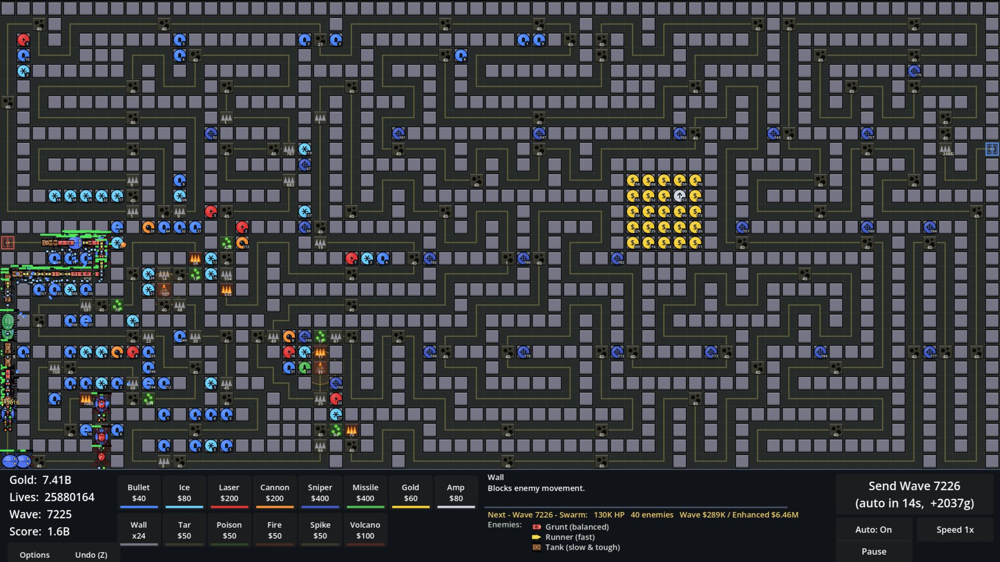
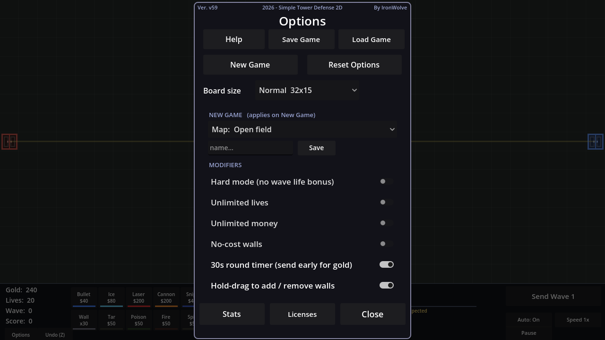

# Simple Tower Defense 2D

**Build a maze. Make every tile count.**

An endless tower defense game about clever routes, tower combinations, and surviving one more wave.

  

[**Download**](#download) · [**Features**](#features) · [**Towers & traps**](#towers--traps) · [**Controls**](#controls) · [**Release notes**](https://github.com/IronWolve/SimpleTowerDefense/releases)

*An established maze in action. Gameplay screenshot from v58.*

Place walls to shape the enemy route, cover the bends with towers, and turn long corridors into traps. Invest in damage, slow enemies down, or build an economy that can keep up with the next wave. Towers, vehicles, and combat effects are drawn in code.

## Download

**[Latest release →](https://github.com/IronWolve/SimpleTowerDefense/releases/latest)**

| Platform | v59 download |
|:--|:--|
| **Windows** · x86-64 | [Download ZIP](https://github.com/IronWolve/SimpleTowerDefense/releases/download/v59/SimpleTowerDefense2D_win_v59.zip) |
| **Linux** · x86-64 | [Download ZIP](https://github.com/IronWolve/SimpleTowerDefense/releases/download/v59/SimpleTowerDefense2D_linux_v59.zip) |
| **macOS** · Intel & Apple Silicon | [Download ZIP](https://github.com/IronWolve/SimpleTowerDefense/releases/download/v59/SimpleTowerDefense2D_osx_v59.zip) |
| **Web** · browser package | [Download ZIP](https://github.com/IronWolve/SimpleTowerDefense/releases/download/v59/SimpleTowerDefense2D_web_v59.zip) |

Desktop downloads include the game runtime. The Web package needs HTTP(S) hosting. macOS requires 10.13+ on Intel or 11+ on Apple Silicon; the app is ad-hoc signed and is not notarized.

See the [v59 release notes](https://github.com/IronWolve/SimpleTowerDefense/releases/tag/v59) for changes, checksums, and platform testing details.

## Features

- **Build the route.** Shape the battlefield with walls while keeping an open path from entrance to exit.
- **Combine eight towers and five traps.** Mix direct damage, splash, slowing effects, and support pieces. Placement matters as much as upgrades.
- **Keep the waves coming.** Fight grunts, runners, and tanks in rotating Steady, Swarm, Heavy, and Squads formations. Boss waves arrive at 5, 15, 25, and beyond.
- **Choose your battlefield.** Play an Open field, a Spiral, or a generated labyrinth. Design and save custom maps, with three board sizes to choose from.
- **Play at your own pace.** Pause to plan, automate wave starts, or queue waves in batches. Speed settings range from ¼× to 1000×; the achieved speed depends on the workload and your machine.
- **Save the run.** Named saves preserve the board and battle in progress. Autosaves after cleared waves let you continue from a checkpoint.
- **Tune the challenge.** Try Hard mode, unlimited lives or money, free walls, and an optional round timer that rewards early wave starts.
- **Spend less time clicking.** Undo, drag building, line placement, bulk upgrades, mass deletion, zoom, and pan are built in.

<strong>See the options</strong>

## Towers & traps

### Towers

| Tower | What it brings to the maze |
|:--|:--|
| **Bullet** | Affordable single-target fire for your opening defense. |
| **Ice** | A slowing field that keeps enemies in range longer. |
| **Laser** | Focused beam damage against a single target. |
| **Cannon** | Explosive shells that punish tightly packed enemies. |
| **Sniper** | Long-range, high-damage shots. |
| **Missile** | Homing projectiles with splash damage. |
| **Gold Mine** | More gold from kills, stacking across the board. |
| **Amplifier** | Stronger effects from the eight adjacent pieces, including Gold Mines. |

### Traps

| Trap | Effect |
|:--|:--|
| **Tar** | Slows enemies crossing it. |
| **Poison** | Deals damage over time and makes enemies more vulnerable. |
| **Fire** | Burns enemies for heavier damage over time. |
| **Spike** | Deals contact damage as enemies pass over it. |
| **Volcano** | Periodic eruptions damage enemies in an area. |

**Try this:** put slowing pieces near a bend, cover the approach with splash damage, and use an Amplifier where it can reach several pieces at once. Runners resist Poison and Tanks resist Fire, so a mixed defense helps.

## Controls

| Input | Action |
|:--|:--|
| Left-click | Place a piece or open its upgrade controls |
| Right-click | Sell a wall, open a piece’s sell controls, or close the active popup |
| Alt + drag | Place pieces in a straight line; right-drag to remove walls |
| Mouse wheel / middle-drag | Zoom / pan |
| **Space** | Pause or resume |
| **Enter** | Send the next wave |
| **T** / **Y** | Queue the next 10 / 100 waves |
| **+** / **−** | Increase / decrease game speed |
| **Q** / **W** / **E** | Upgrade the selected piece by up to 1 / 10 / 100 levels |
| **Shift + E** | Buy as many upgrades as you can afford |
| **D** | Delete the piece under the cursor |
| **F** | Toggle mass-delete mode; drag to remove pieces |
| **Z** | Undo |
| **Esc** | Close a dialog or tool, then open or close Options |
| **F11** | Toggle fullscreen |

Open **Options → Help** for the in-game guide, stats, and more shortcuts. Save, Load, and lifetime Stats are also in Options.

## License & credits

Created by [IronWolve](https://github.com/IronWolve), using [Godot Engine](https://godotengine.org/). Licensed under the [MIT license](LICENSE).

Godot and its bundled components retain their own licenses. Notices are available under **Options → Licenses**, in the platform downloads, and in the [supplemental release notices](https://github.com/IronWolve/SimpleTowerDefense/releases/download/v59/THIRD_PARTY_LICENSES.txt).

Made a fork, a mod, or a video? A heads-up on [GitHub](https://github.com/IronWolve) is always welcome; it is not a license requirement.
